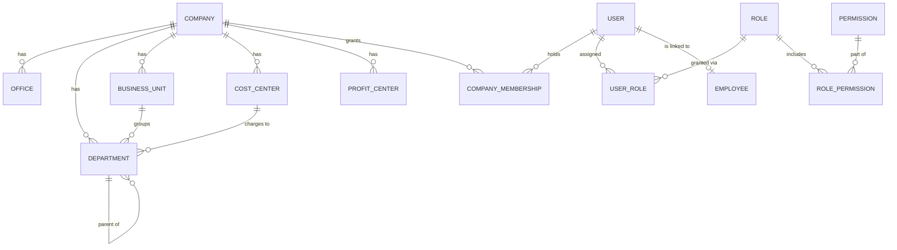
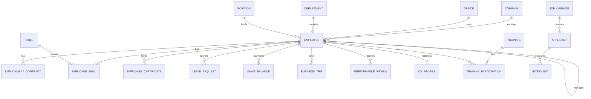
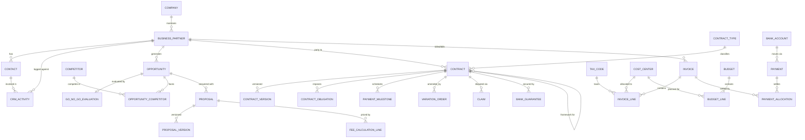
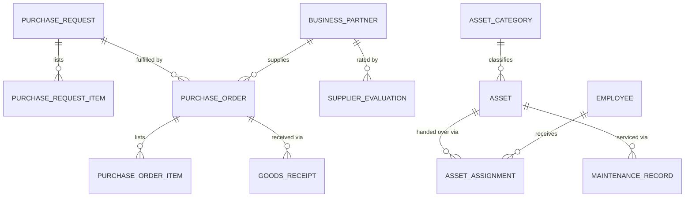
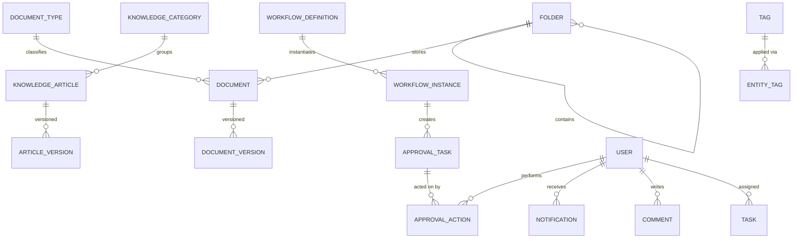

# 04 — Entity Relationship Diagram

Rendered as Mermaid (GitHub/VS Code preview). Split by domain for readability;
cardinality shown at the "many" end. Full attribute detail lives in `schema.prisma`.

## Core: Organization & Identity

## HR

## CRM → Sales → Contracts → Finance (the revenue chain)

## Procurement & Assets

## Documents, Workflow, Cross-cutting

Polymorphic links (`entityType` + `entityId`, application-enforced): comments, attachments,
entity_tags, tasks, custom_field_values, favorites, notifications, audit_logs, activity_logs,
workflow_instances → any business entity.
