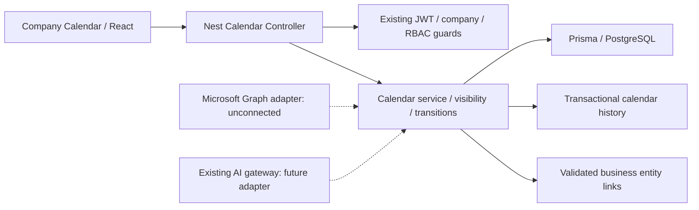

# Company Calendar architecture

Discovery: 2026-10-12. This describes the working checkout, including pre-existing uncommitted work.

## Repository inventory

- pnpm 9 monorepo: `apps/api`, `apps/web`, `packages/shared`.
- API: NestJS 10 on Express, Prisma 5/PostgreSQL, URI-versioned REST (`/api/v1`), Swagger, class-validator DTOs. No MUI or plain Express routing layer.
- Web: React 18/Vite/Tailwind tokens, Lucide icons, TanStack Query, Zustand auth, React Router, i18next DE/EN. Reuse this UI rather than introduce MUI.
- JWT and Entra OIDC identity already exist. Global guards resolve membership from X-Company-Id, then company-scoped RBAC. System administration does not override private calendar visibility.
- Existing company, CRM activities/partners, sales opportunities/proposals, contracts/expiry, invoices, HR leave/training, meeting minutes, notifications, AuditLog, SavedView and OutboxEvent are integration points. Meeting minutes are not calendar appointments. Task scheduling remains separate.
- Cron via Nest Schedule and notification service exist. Redis is declared in compose, but no durable queue worker is implemented. Existing AI gateway supports provider selection; no Microsoft calendar sync exists.
- Prisma soft-delete extended client assumes most models have deletedAt. New calendar code uses explicit scoped base-client queries and transactional writes.
- Deployment currently uses local/container API plus PostgreSQL. No publicly reachable Graph webhook or calendar app credentials verified.

## Decisions

1. Calendar lives at `/company-calendar` beside corporate management, API at `/api/v1/business-calendar`. Additive tables; never modify source module dates.
2. OCTA owns manual obligations; future Graph mirror fields belong to Outlook. Unconfigured integrations report unconnected and cannot create external writes.
3. Date-only values are validated ISO calendar strings, not UTC midnight. Timed appointments require explicit offsets and original IANA timezone. All-day end date is exclusive. Hard due, internal target and forecast remain distinct.
4. Calendar module permission intersects with company membership, domain permission and sensitivity. Private records only creator/owner/explicit grantee; restricted/team records require explicit grants. Finance/HR require domain read rights even for owners. Counts and history use the same predicate.
5. Updates require optimistic version and preserve immutable transactional history. Completion requires checklist/evidence as configured. Recurrence uses a deliberately bounded date-only daily/weekly/monthly/yearly rule; no statutory deadlines or holidays inferred.
6. Core feature is controlled by server COMPANY_CALENDAR_ENABLED (off unless true). UI discovers capability; rollout follows schema install and permission grant. Graph/AI/Teams stay unconnected until their later phases.
7. No queue worker is invented for Graph. Completion generates the next recurrence transactionally with unique series/occurrence identity; retries cannot create another occurrence. Background reminders and full RRULE are deferred explicitly.

## Baseline

`pnpm typecheck`, `pnpm test` (121 API + 8 web), `pnpm build` pass. Existing frontend bundle-size warning. `pnpm lint` fails because ESLint is not installed/configured. No AGENTS.md found in workspace or ancestor directories checked.

## Migration / rollback

Capture the current Prisma schema as the migration baseline before adding tables. Generate an additive SQL diff from that snapshot, not from the live database (the checkout already contains unrelated schema changes). Apply only calendar SQL using Prisma db execute after backup. Test in disposable PostgreSQL schemas; do not reset or seed production. Roll back deployment by disabling the flag; retain calendar tables/history for recovery. No destructive down migration.
